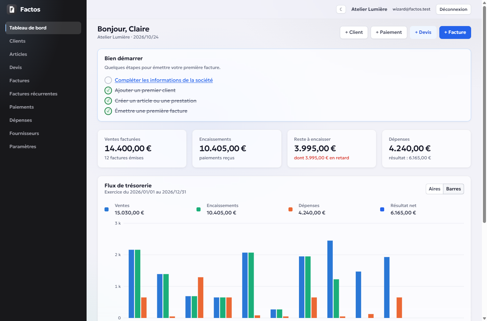
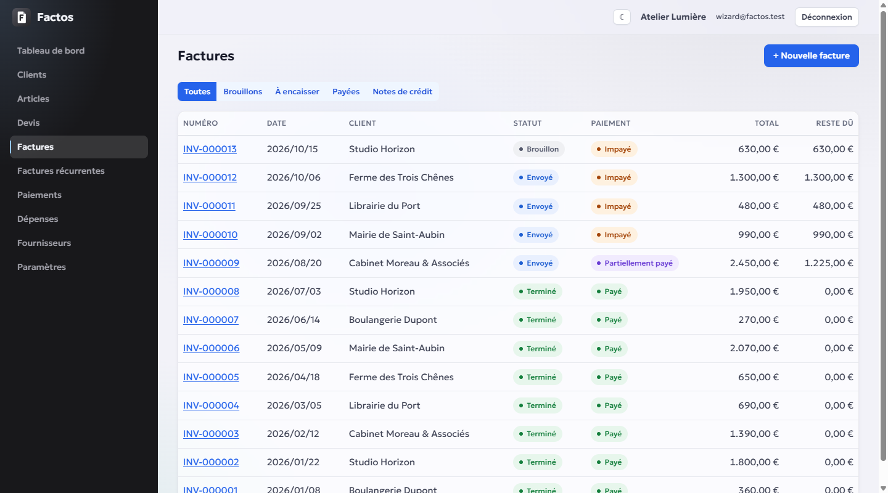
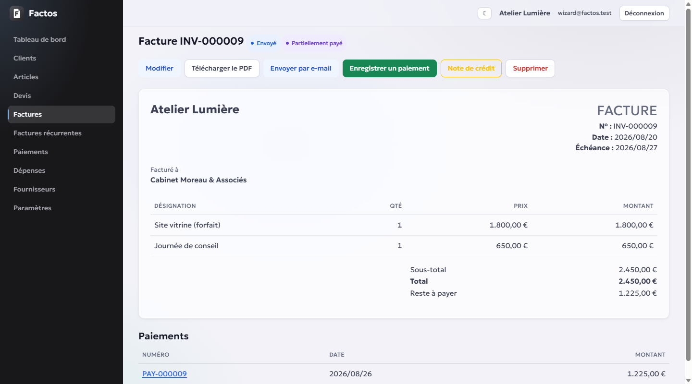
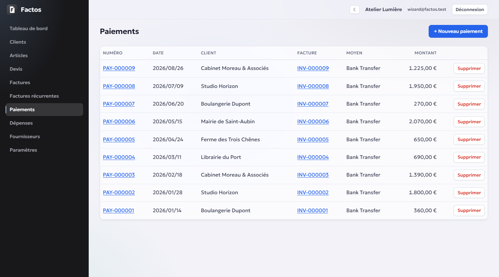
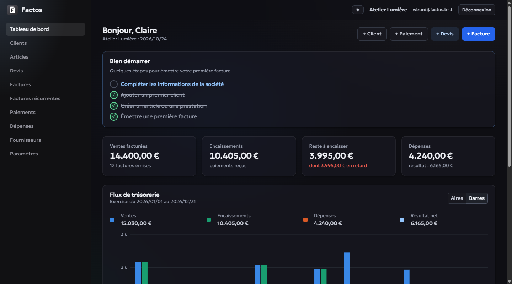
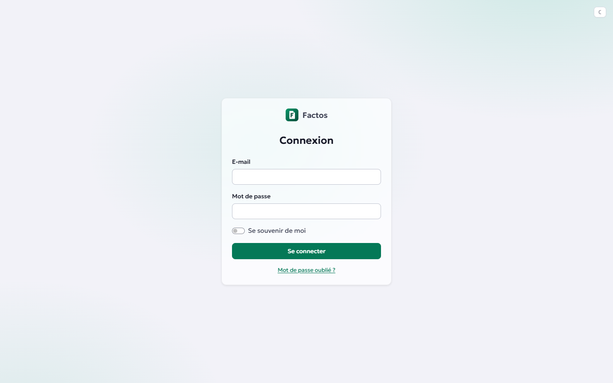

# Factos

A clone of [InvoiceShelf](https://github.com/InvoiceShelf/InvoiceShelf) rewritten in **C# / Blazor** (.NET 10): estimates, invoices, payments, expenses and purchasing, with an InvoiceShelf-compatible REST API.

> **Status: under development.** The web UI is usable end to end; the `/api/v1` API is only partially ported (Accounts domain). The mobile app (iOS / Android) lives in a separate repository.



## Features

- **Sales**: customers, items, estimates, invoices, recurring invoices (cron), credit notes, payments split across several invoices, customer credits.
- **Purchasing**: suppliers, supplier invoices and credit notes, payments, refunds.
- **Expenses** and a cash-flow **dashboard** (area / bar charts).
- **PDF** (QuestPDF) with customizable templates, **email delivery** (SMTP) with open tracking, public links for customers.
- **Logo**, 4 UI themes, light / dark mode.
- **Three databases**, chosen at install time: SQLite, PostgreSQL or MySQL.
- **Import** from an existing InvoiceShelf installation (accounts, passwords and API tokens are kept).
- **API parity**: an existing InvoiceShelf API client should work unchanged (Sanctum Bearer auth, Laravel-style envelopes and errors).

| Invoices | Invoice detail |
|---|---|
|  |  |

| Payments | Dark theme |
|---|---|
|  |  |



## Roadmap

- [ ] **API updates**: complete the `/api/v1` endpoints to reach full parity with InvoiceShelf (roles, members, contacts, currencies, sales documents…).
- [ ] **Mobile app**: iOS and Android, .NET MAUI Blazor Hybrid, talking to the `/api/v1` API (separate repository).
- [ ] **Plugin management**: hot-installable extensions (v2).
- [ ] **Automatic backup module**: database and files (logos, uploads).
- [ ] **Two-factor authentication (2FA)**: TOTP codes with recovery codes.
- [ ] **Passkey authentication**: passwordless sign-in (WebAuthn).

## Quick start

### Docker

```bash
docker compose up -d
```

Open http://localhost:8080: the setup wizard walks you through the database, the administrator account and the company. All persistent state lives in the `/app/App_Data` volume.

### From source

```bash
dotnet run --project src/Factos
```

Open http://localhost:5221. On first launch, the `/setup` wizard writes `appsettings.local.json` and then stops the process: run the command again.

## Updates

- **Schema**: no migration ever runs at startup; a pending migration redirects to `/update`, where a super admin confirms.
- **Application**: Settings › Updates downloads the latest GitHub release.

## Development

```bash
dotnet build
dotnet test tests/Factos.Tests
```

Any change to the data model requires all three migrations (SQLite, PostgreSQL, MySQL). Project conventions, architecture and known API differences are documented in [CLAUDE.md](CLAUDE.md) (in French).

## Licence

GNU AGPL v3 ou ultérieure (`AGPL-3.0-or-later`) — voir [LICENSE](LICENSE).
